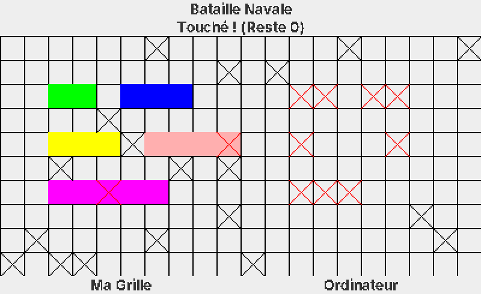

# Battleship (Bataille Navale) in Java

A Battleship game against the computer, built in **Java with Swing** for the Object-Oriented Programming course at **ESAIP** engineering school. The project is organised around the **Model-View-Controller** pattern and uses inheritance to model the different ship types.

<p align="center">
  
</p>

**Stack:** Java · Swing (AWT graphics) · Object-oriented programming · MVC

## Gameplay

- Two 10×10 grids: **your fleet** on the left, the **computer's fleet** (hidden) on the right.
- Each turn, you fire a **salvo of 3 shots** by clicking on the computer's grid, then the computer replies with 3 shots of its own.
- Every shot is announced in the banner: *A l'eau !* (miss), *Touché !* (hit) or *Touché Coulé !* (sunk), along with the number of shots left this turn.
- Hits are marked with a red cross and misses with a black cross. Shooting twice at the same cell is not allowed, for the player or for the computer.

### The fleet

| Ship | Class | Size |
|---|---|---|
| Aircraft carrier | `PorteAvions` | 5 cells |
| Battleship | `Cuirasse` | 4 cells |
| Cruiser | `ContreTorpilleur` | 3 cells |
| Submarine | `SousMarin` | 3 cells |
| Destroyer | `LanceTorpille` | 2 cells |

## Getting started

**Requirements:** a Java Development Kit (JDK), version 8 or later. Free download: [Adoptium](https://adoptium.net/).

From the project folder:

```bash
javac -encoding UTF-8 Application.java */*.java
java Application
```

## Project structure

```
Application.java              Entry point: opens the game window
│
├── modele/                   MODEL: game data and rules
│   ├── Bateau.java           Base ship class: positions, hits, sunk status
│   ├── PorteAvions.java      ┐
│   ├── Cuirasse.java         │
│   ├── ContreTorpilleur.java │ Subclasses: each sets its size and colour
│   ├── SousMarin.java        │
│   ├── LanceTorpille.java    ┘
│   ├── Flotte.java           A player's fleet: shots received, hit detection
│   ├── Position.java         A single cell (x, y, hit or not)
│   └── Dessinable.java       Interface for every element drawn on screen
│
├── vue/                      VIEW: everything the player sees
│   ├── Fenetre.java          Main window holding both grids
│   ├── PanneauGrille.java    Draws a grid, its ships and shots; computer's turn
│   └── PanneauInformation.java  Top banner with game messages
│
└── controleur/               CONTROLLER: user input
    └── GestionSouris.java    Turns mouse clicks into shots, manages the 3-shot salvo
```

### OOP concepts demonstrated

- **Inheritance:** the five ship types extend a common `Bateau` class and only define what makes them different (size, colour).
- **Interface:** `Dessinable` gives every drawable element a common `dessiner()` method.
- **Encapsulation:** attributes are private and only changed through methods such as `salve()` or `touche()`.
- **Separation of concerns:** game logic (`modele`), display (`vue`) and user input (`controleur`) live in separate packages.

## Known limitations

This was a coursework project, built to practise object-oriented design rather than to ship a finished game. The main limitations:

- **Fixed ship positions.** The fleet is hardcoded in `Flotte.initialiser()`, all ships horizontal. Both players get the same layout, so your own grid reveals where the enemy ships are.
- **No placement validation.** There is no check that ships stay inside the grid or do not overlap. This is harmless with fixed positions, but would be needed for random placement.
- **No end of game.** `finPartie()` always returns `false`, so no winner is declared once a fleet is sunk. If play carries on until the computer has fired at all 100 cells, its search for a free cell never ends and the game freezes.
- **Basic opponent.** The computer fires at random cells, with no targeting after a hit.
- **Minimal interface.** Small fixed-size grids without coordinates, and sunk ships disappear from your grid instead of being shown as sunk.
- **No unit tests.**

## Possible improvements

- Random ship placement, horizontal and vertical, with bounds and overlap checks
- A real end of game with a winner screen and a rematch option
- A smarter computer that targets neighbouring cells after a hit
- Unit tests for the model (`Flotte`, `Bateau`) with JUnit

## Author

**Nathanaël Bousseau**, AI engineering student at ESAIP · [LinkedIn](https://www.linkedin.com/in/nathana%C3%ABlbousseau/)
